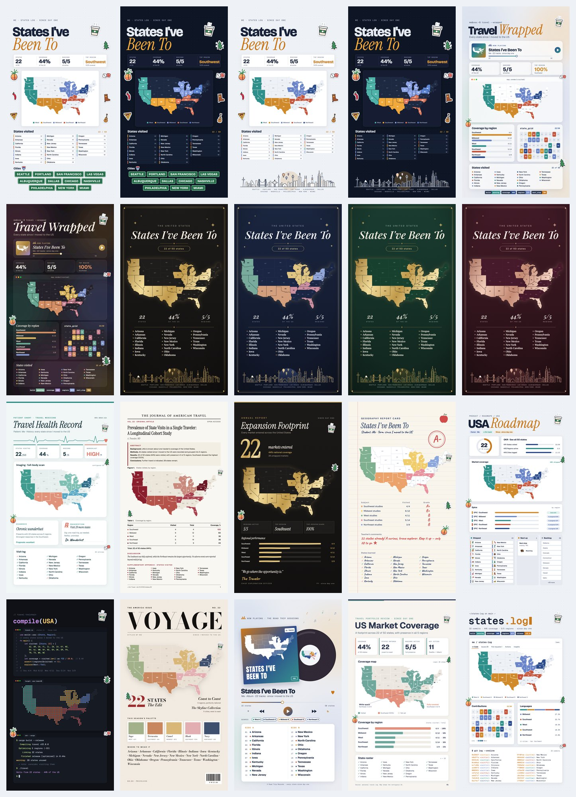

# US Travel Story 🗺️✨

Turn the US states you've visited into an aesthetic **Instagram Story** (1080 × 1920 px, 9:16).
14 ready-made designs: soft editorial posters, a "Travel Wrapped" recap, a vinyl album, an MBA-style slide and a developer dashboard. They all come from one small file with your own states and cities.



---

## Quick start (about 2 minutes)

1. **Download** this repo (green **Code** button → *Download ZIP*) and unzip it.
2. **Open `my-travel.js`** in any text editor and change it to your own info:

   ```js
   window.CONFIG = {
     name: "Me",
     title: "States I've Been To",
     since: "since I moved to the US",
     sinceShort: "since day one",
     states: ["California", "New York", "Texas"],
     cities: ["San Francisco", "Chicago", "New York"]   // west → east looks best
   };
   ```

3. **Preview:** double-click `generator/index.html`. A gallery of all designs opens, and you can click any one to see it full size.
4. **Export PNGs** (needs Google Chrome):

   ```bash
   ./scripts/render.sh          # every design → out/
   ./scripts/render.sh 58 57    # only designs 58 and 57
   ```

5. Post the PNG to your Story. It's already exactly 1080 × 1920.

> No Terminal? Open a design full size in Chrome, then press **Cmd+Opt+I → Cmd+Shift+P → "Capture full size screenshot"** with the device set to 1080 × 1920.

Want an AI to do it for you instead? Use the **[prompt kit](prompt-kit/)**.

---

## What's calculated for you

Everything comes from your `states` list, so nothing needs to be typed twice:

- states visited, percent of the US, and states still to go
- regions active (West / Southwest / Midwest / Southeast / Northeast) with per-region progress
- your **top region** and **white-space region** (used in the MBA slide notes)
- which coasts you've reached (used in the tech dashboard's JSON card)
- track count, Side A / Side B split, list columns and row spacing

## Designs

| # | Name | Vibe |
|---|------|------|
| 58 | travel-wrapped | Year-in-review recap mixing music, MBA and tech cards |
| 57 | music-album | Vinyl, album sleeve, player, Side A / B tracklist |
| 55 | mba-market-coverage | Consulting slide: KPI cards, annotated map, bar chart |
| 56 | tech-dashboard | Terminal prompt, badges, state grid, `stats.json` |
| 51 / 52 | luxe-sky / luxe-cream | Gold frame, linen texture, line-art skyline |
| 53 / 54 | pop-pink / pop-sunset | Colorful Instagram style with sticker title |
| 48 / 49 | sky / lavender, skyline on top | Soft editorial |
| 47 / 50 | sage / terracotta | Soft editorial |
| 45 / 46 | travel-map-cream / places-blush | The originals |

### City skylines

These cities have hand-drawn landmarks: **Seattle** (Space Needle), **Portland** (Mt. Hood), **San Francisco** (Golden Gate), **Las Vegas** (the welcome sign), **Albuquerque** (adobe and balloons), **Dallas** (Reunion Tower), **Chicago**, **Nashville**, **Philadelphia** (City Hall), **New York** and **Miami** (palms).
Any other city still shows up, with a generic skyline and its name. The skyline resizes itself to fit however many cities you list.

## Instagram Story tips

- Every export is **1080 × 1920 px (9:16)**, the native Story size, so Instagram won't crop or blur it.
- Instagram covers about the **top 250 px** (profile bar) and **bottom 250 px** (reply box). Titles and maps sit inside that safe zone.
- To make it interactive, add Instagram's **Poll** or **Question** sticker ("Where should I go next?") in an empty corner.

## Folder layout

```
my-travel.js          ← edit me
generator/index.html  ← all designs (open in a browser)
generator/data/       ← US + world map shapes
scripts/render.sh     ← export PNGs with Chrome
prompt-kit/           ← copy-paste prompts for Claude / ChatGPT
examples/featured/    ← the 14 designs, rendered
examples/all-versions/← every earlier exploration (60+ styles)
```

## Credits

Map shapes come from [us-atlas](https://github.com/topojson/us-atlas) and [world-atlas](https://github.com/topojson/world-atlas), based on Census Bureau and Natural Earth data. The maps are drawn with [d3](https://d3js.org) and fonts are from Google Fonts. Landmarks are original line drawings, not logos.

Code is MIT licensed, so remix it freely. If you post one, tag it so others can find the template. 💌
